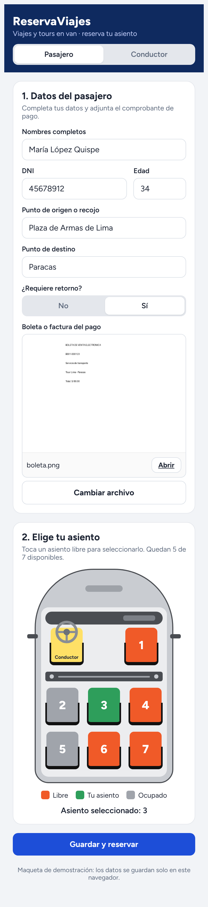
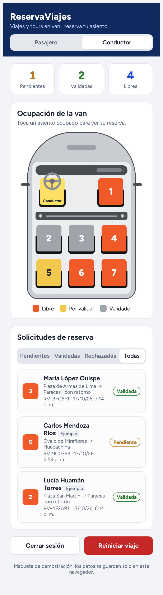
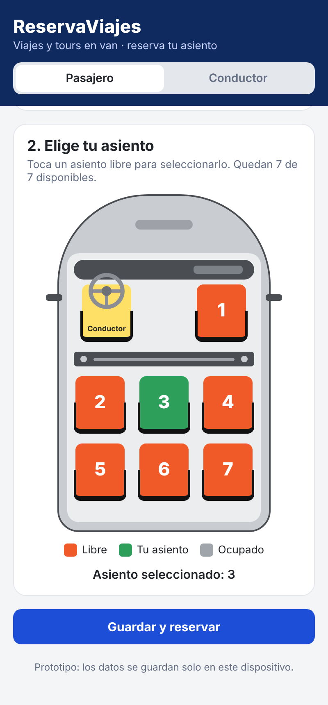
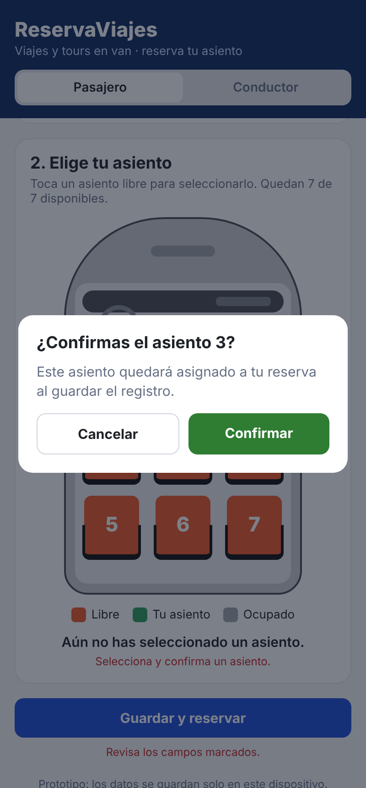
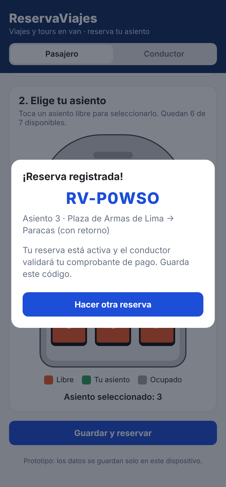
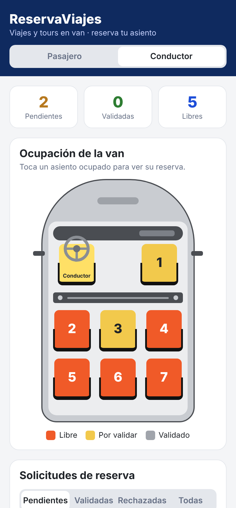
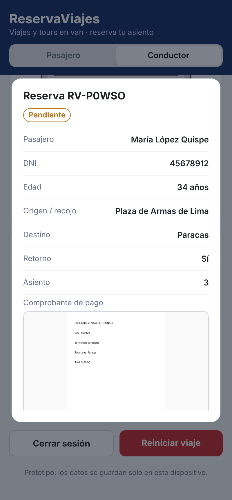
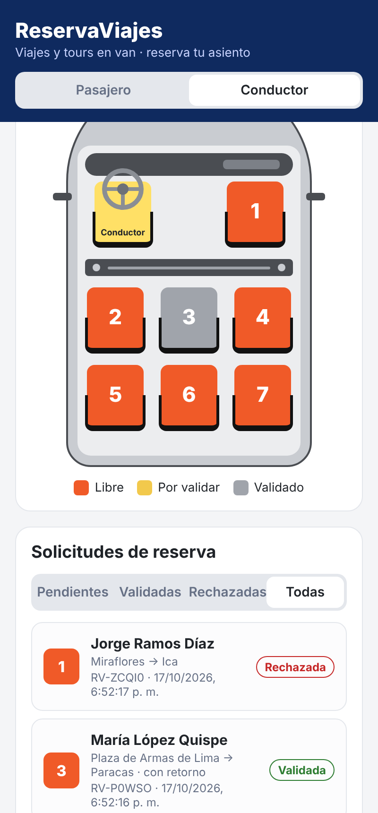

# ReservaViajes

Prototipo de app móvil para un servicio de transporte de viajes y tours en van: los pasajeros registran sus datos, adjuntan su comprobante de pago y eligen asiento; el conductor (administrador) valida o rechaza las reservas.

## Maqueta (empieza aquí)

Abre [`maqueta/reservaviajes.html`](maqueta/reservaviajes.html) con doble clic en cualquier navegador; no hace falta instalar nada. Las decisiones, los requisitos y el historial del proyecto están en [`docs/REGISTRO.md`](docs/REGISTRO.md).

| Pasajero | Conductor |
| --- | --- |
|  |  |

## Prototipo Expo

También hay un prototipo de app hecho con [Expo](https://expo.dev) (React Native + TypeScript), así que el mismo código corre en Android, iOS y navegador.

## Paneles

| Panel | Qué hace |
| --- | --- |
| **1. Datos del pasajero** | Nombres completos, DNI (8 dígitos), edad, punto de origen o recojo, punto de destino, ¿requiere retorno? (Sí/No) y carga de la boleta o factura (foto o PDF). |
| **2. Selección de asiento** | Van vista desde el techo: conductor con timón (no seleccionable) + 7 asientos. Al tocar un asiento libre se abre una ventana para confirmarlo; luego **Guardar y reservar** registra los datos y activa la reserva (queda *pendiente* de validación). |
| **3. Conductor** | Acceso con PIN (demo: `1234`). Muestra la ocupación de la van, contadores, lista de solicitudes filtrable y el detalle de cada reserva con su comprobante para **Validar** o **Rechazar** (rechazar libera el asiento). Incluye “Reiniciar viaje” para borrar todo. |

Distribución de asientos (vista desde el techo):

```
 [Conductor]      [1]
 ─────────────────────
 [2]   [3]   [4]
 [5]   [6]   [7]
```

## Probarlo

```bash
npm install
npm run web        # abre en el navegador
npm start          # muestra un QR para abrirlo en el celular con Expo Go
```

## Alcance del prototipo

- No hay backend: las reservas se guardan en el propio dispositivo/navegador (AsyncStorage). El pasajero y el conductor deben usar el mismo dispositivo para ver los mismos datos.
- El PIN del conductor es fijo (`1234`) y solo sirve para la demo.
- Hay un solo viaje con 7 asientos; aún no se manejan fechas, rutas ni varias unidades.

## Capturas del prototipo Expo

| Pasajero | Confirmar asiento | Reserva registrada |
| --- | --- | --- |
|  |  |  |

| Conductor | Detalle con comprobante | Tras validar / rechazar |
| --- | --- | --- |
|  |  |  |
